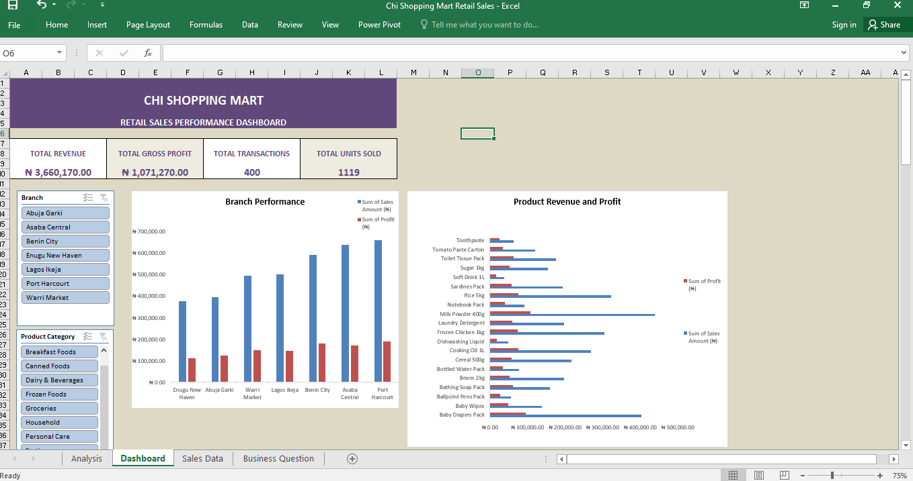
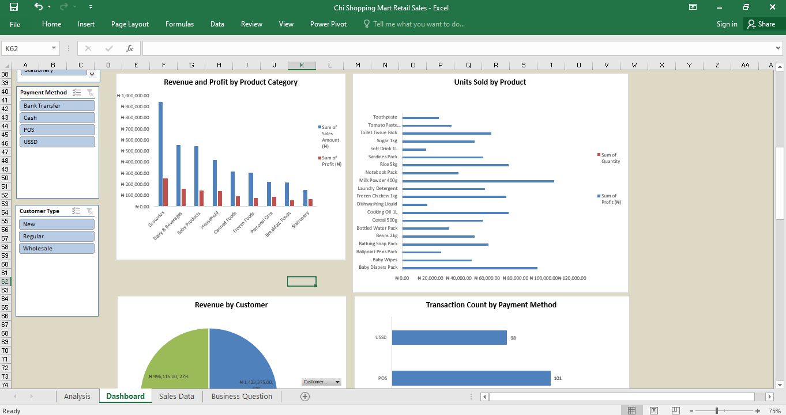
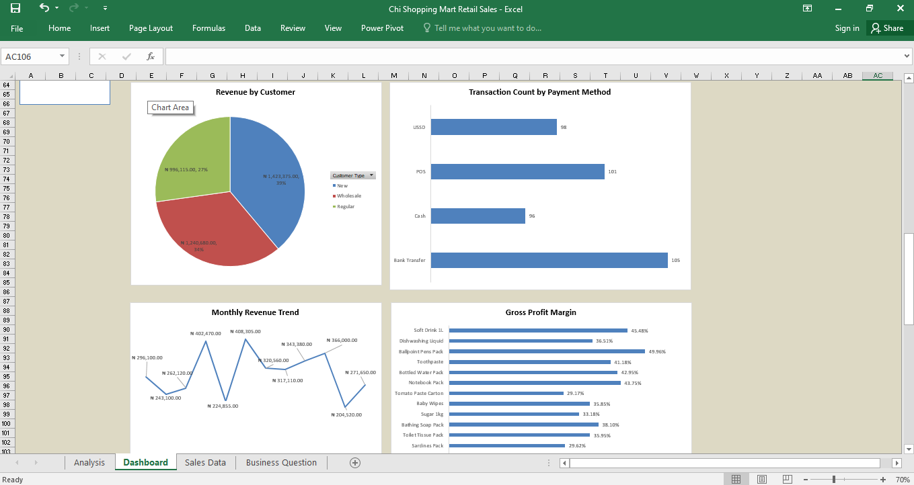

Chi Shopping Mart – Retail Sales Analysis

Project Overview

This project examines the sales performance of Chi Shopping Mart using Microsoft Excel. The analysis focuses on revenue, gross profit, product performance, branch performance, customer types and payment methods.

An interactive dashboard was developed to help users explore the results and compare business performance using different filters.
## Dashboard Preview

### Additional Dashboard Views

### Analysis Findings

Tools Used

- Microsoft Excel 2016
- PivotTables and PivotCharts
- Excel formulas and functions
- Slicers
- Interactive dashboard

Project Objectives

- Evaluate overall sales revenue and gross profit.
- Identify products generating the highest revenue.
- Compare sales performance across branches.
- Examine sales across different customer types and payment methods.
- Analyse monthly revenue trends.
- Present the results through an interactive dashboard.

Key Findings

- Total revenue: ₦3,660,170.
- Total gross profit: ₦1,071,270.
- Total transactions: 400.
- Total units sold: 1,119.
- Overall gross profit margin: 29.27%.
- Milk Powder 400g recorded the highest product revenue at ₦438,880.
- Port Harcourt recorded the highest branch revenue at ₦660,550.
- New Customers generated the highest revenue at ₦1,423,375.

Dashboard Features

The dashboard includes four interactive slicers:

- Branch
- Product Category
- Payment Method
- Customer Type

The slicers allow users to filter the dashboard and explore different parts of the sales performance.

Project Files

- Excel workbook: Contains the sales analysis, PivotTables and interactive dashboard.
- PDF documentation: Explains the project, analysis process and findings.
- Screenshots: Provide visual previews of the dashboard and analysis.

Conclusion

This project demonstrates how Microsoft Excel can be used to organise, analyse and present retail sales data. The findings provide a clearer view of business performance and areas that management may want to investigate further.# chi-shopping-mart-retail-sales-analysis
Retail sales analysis and interactive dashboard developed using Microsoft Excel.
